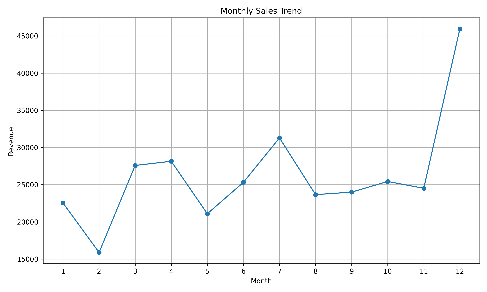
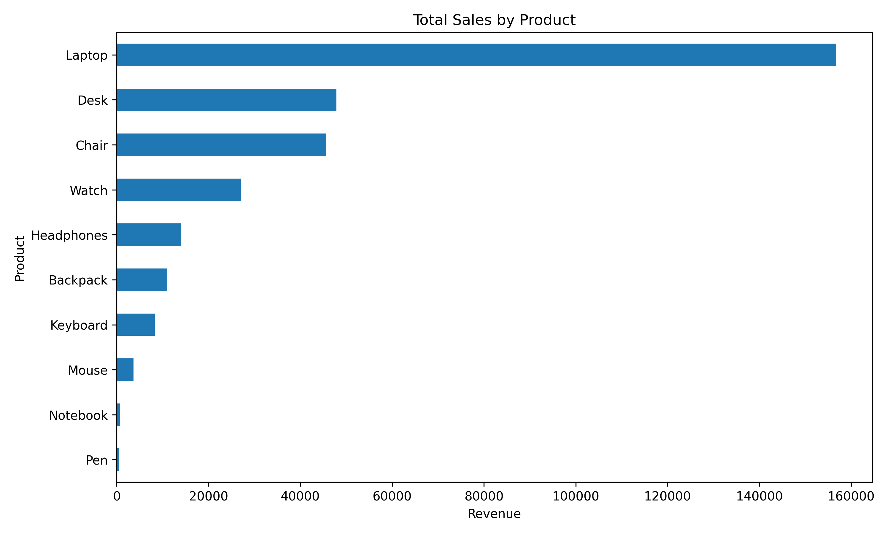
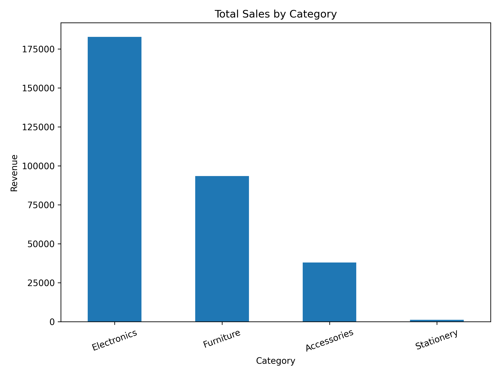
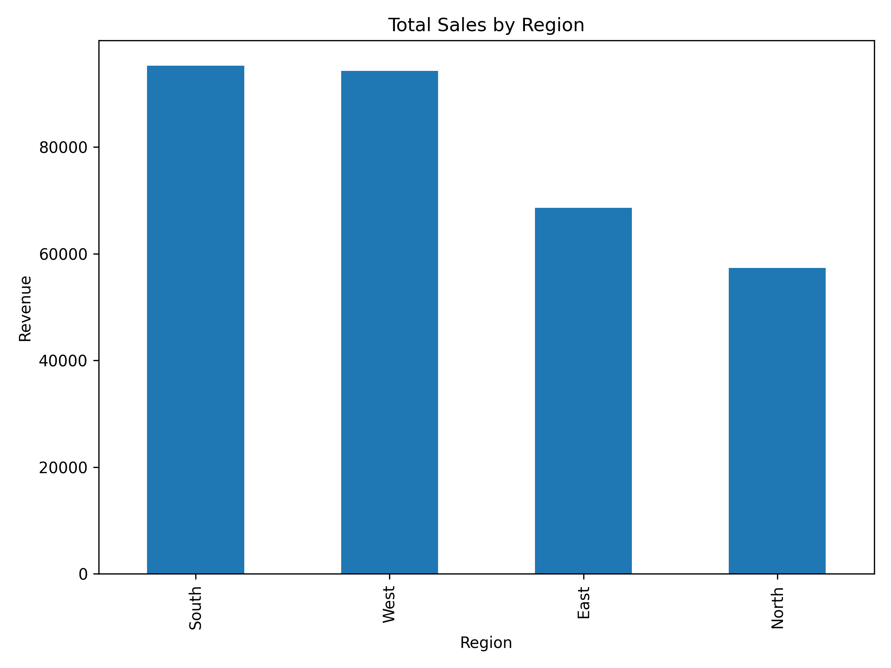

# Sales Data Analysis

## Project Overview

This project performs an exploratory sales data analysis
using Python.

The dataset contains 500 synthetic sales orders from an
e-commerce business during 2025.

The project focuses on data cleaning, sales analysis,
business insights, and data visualization.

## Technologies

- Python
- Pandas
- Matplotlib

## Dataset

The dataset contains the following columns:

- Order_ID
- Date
- Product
- Category
- Quantity
- Unit_Price
- Total_Sales
- Region

## Analysis

The project includes:

- Dataset overview and data quality checks
- Missing values and duplicate detection
- Total revenue and average order value
- Product performance analysis
- Category sales comparison
- Regional sales analysis
- Monthly sales trends
- Business insights generation

## Key Findings

- Total Revenue: 315,416.73
- Total Orders: 500
- Average Order Value: 630.83
- Total Items Sold: 1,457
- Top Product: Laptop
- Top Category: Electronics
- Top Region: South
- Best Sales Month: December


## Visualizations

### Monthly Sales Trend


### Sales by Product


### Sales by Category


### Sales by Region



## How to Run

Clone the repository:

```bash
git clone YOUR_REPOSITORY_URL
```

Navigate to the project:

```bash
cd sales-data-analysis
```

Create a virtual environment:

```bash
python3 -m venv .venv
```

Activate it:

```bash
source .venv/bin/activate
```

Install dependencies:

```bash
pip install -r requirements.txt
```

Generate the dataset:

```bash
python3 src/generate_data.py
```

Run the analysis:

```bash
python3 src/analysis.py
python3 src/visualizations.py
python3 src/insights.py
```

## Important Note

This project uses synthetic data generated for educational
and portfolio purposes. The findings do not represent
actual business performance.

